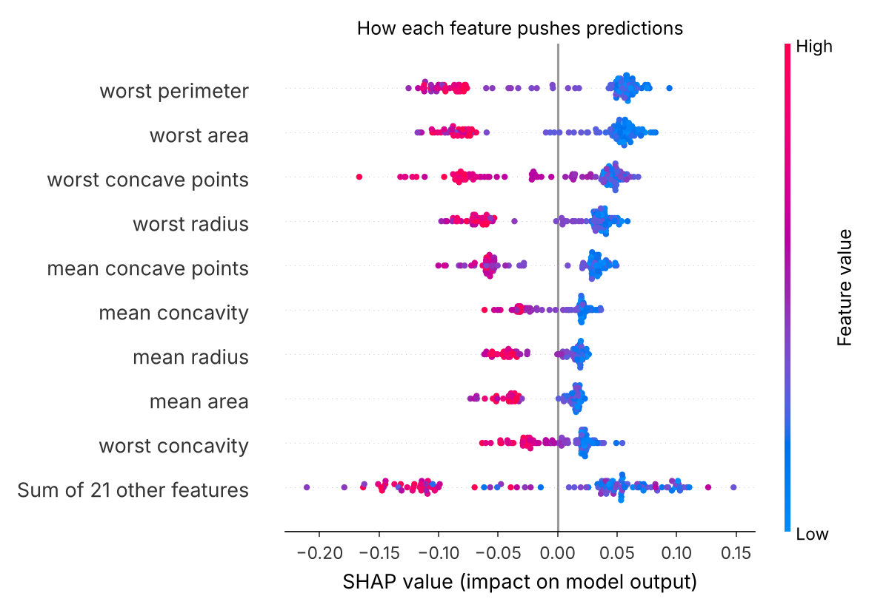

# Explain a Machine Learning Model with SHAP

Train a Random Forest on the scikit-learn breast cancer dataset, then use SHAP to explain it:
which features matter most overall, and why the model made one specific prediction.



## Results

- Test accuracy: 94.7% (114 test samples)
- Top features: worst perimeter, worst area, worst concave points, worst radius, mean concave points

## Plots produced

| File | Shows |
|---|---|
| `plots/shap_bar.png` | Top 10 features by average impact |
| `plots/shap_beeswarm.png` | Direction and size of each feature's effect |
| `plots/shap_waterfall_sample0.png` | Why the model classified one tumour as malignant |

## How to run

```bash
git clone https://github.com/zaima-20/shap-explainability.git
cd shap-explainability
pip install -r requirements.txt
python explain_model_with_shap.py
```

No download needed: the dataset is built into scikit-learn.

## Author

**Zaima Sohail** · [GitHub](https://github.com/zaima-20)
